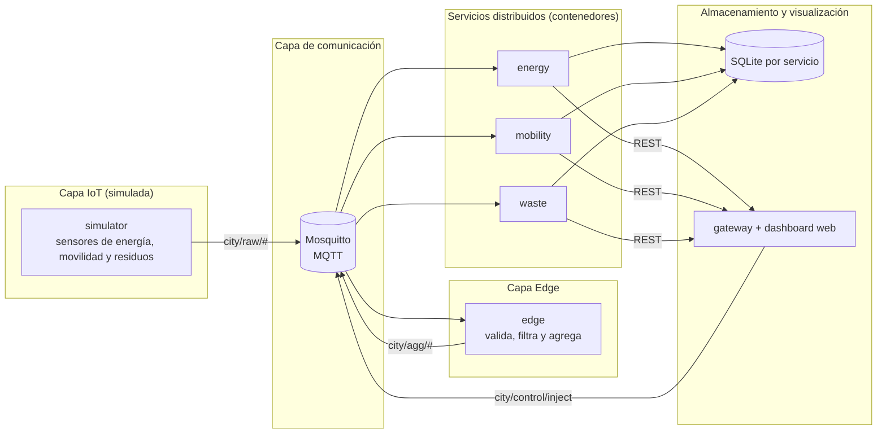

# Ciudad inteligente y sostenible: prototipo de sistema distribuido

Prototipo del taller *Tecnologías emergentes y sostenibles en sistemas distribuidos*. Simula una ciudad colombiana que integra **energía, movilidad y residuos** en una sola plataforma: sensores IoT, procesamiento en el borde (Edge), microservicios en contenedores, análisis con IA ligera y un dashboard web.

> Es un prototipo académico. Los sensores son simulados y el broker no usa autenticación (ver [Limitaciones](#limitaciones)).

## Arquitectura



| Componente | Qué hace |
|---|---|
| `simulator` | Publica lecturas cada segundo (con picos horarios, anomalías y lecturas corruptas ocasionales). El tiempo está acelerado: un día simulado dura ~12 min. |
| `edge` | Descarta lecturas inválidas y envía un resumen (promedio, mín., máx.) cada 5 s. Reduce ~80 % los mensajes hacia los servicios. |
| `energy`, `mobility`, `waste` | Un microservicio por dominio (misma imagen, variable `DOMAIN`). Guardan datos en SQLite, aplican IA ligera y exponen una API REST. |
| `gateway` | Agrega los servicios, sirve el dashboard y permite inyectar anomalías. |

**IA incluida (ligera a propósito, para ahorrar cómputo):**
- *Energía y movilidad:* detección de anomalías con z-score sobre la variación entre lecturas.
- *Residuos:* regresión lineal que estima en cuánto tiempo se llena cada contenedor.

## Requisitos

- [Docker Desktop](https://www.docker.com/products/docker-desktop/) (Windows, macOS) o Docker Engine con el plugin Compose (Linux).
- Git.
- Un navegador web.

## Instalación y ejecución

```bash
git clone <URL-DE-TU-REPOSITORIO>
cd <carpeta-del-repositorio>
docker compose up --build
```

La primera vez tarda unos minutos mientras descarga las imágenes. Cuando los registros dejen de crecer, abre el dashboard:

**http://localhost:8080**

Para detener todo: `Ctrl+C` y luego `docker compose down`. Para borrar también los datos guardados: `docker compose down -v`.

## Cómo probarlo desde la interfaz gráfica

1. **Abre http://localhost:8080.** Arriba a la derecha debe decir «En línea». En unos segundos aparecen las tres tarjetas con datos y gráficas.
2. **Revisa los datos en vivo.** Energía muestra kW por zona, Movilidad vehículos por minuto y Residuos el nivel de llenado con una estimación de cuándo se llenará.
3. **Prueba el Edge.** En la tarjeta «Edge Computing» verás cuántas lecturas llegaron, cuántas se descartaron por inválidas y el porcentaje de mensajes que se evita enviar.
4. **Genera una anomalía.** Pulsa **Simular anomalía** en Energía o Movilidad. Espera unos 10 a 15 segundos: aparece una alerta en «Alertas recientes» y la gráfica del sensor muestra el salto.
5. **Prueba Residuos.** Pulsa **Simular anomalía** en Residuos: un contenedor sube 35 puntos, la estimación «llena en…» se acorta y, al pasar de 80 %, aparece la alerta «programar recolección».
6. **Prueba la tolerancia a fallos.** En otra terminal ejecuta `docker compose stop waste`. La tarjeta de Residuos mostrará «Servicio no disponible» y las otras dos seguirán funcionando. Recupérala con `docker compose start waste`.

### Pruebas por línea de comandos (opcional)

```bash
curl http://localhost:8080/api/overview            # estado completo en JSON
curl -X POST "http://localhost:8080/api/inject?domain=energy"
docker compose logs -f edge                        # registros de un servicio
```

Para ver los mensajes MQTT en una interfaz gráfica, conecta [MQTT Explorer](https://mqtt-explorer.com/) a `localhost:1883` y observa los topics `city/raw/#` (datos crudos) y `city/agg/#` (datos resumidos por el Edge).

## Configuración

Variables de entorno opcionales del simulador (agrégalas en `docker-compose.yml`, servicio `simulator`):

| Variable | Valor por defecto | Descripción |
|---|---|---|
| `SIM_SPEED` | `120` | Aceleración del reloj simulado (1 s real = 120 s simulados). |
| `SIM_INTERVAL` | `1` | Segundos entre lecturas. |
| `ANOMALY_PROB` | `0.002` | Probabilidad de anomalía espontánea por lectura. |

## Estructura del repositorio

```
├── docker-compose.yml        # orquesta todos los servicios
├── mosquitto/mosquitto.conf  # configuración del broker MQTT
└── app/
    ├── Dockerfile            # una sola imagen para todos los servicios Python
    ├── common.py             # cliente MQTT, validación, agregación, anomalías y predicción
    ├── simulator.py          # capa IoT simulada
    ├── edge.py               # capa Edge
    ├── domain_service.py     # microservicio por dominio
    ├── gateway.py            # API agregadora
    └── static/index.html     # dashboard
```

## Limitaciones

- **Seguridad:** el broker permite conexiones anónimas y sin cifrado. En producción se requiere TLS, autenticación por dispositivo, control de acceso por topic y gestión de secretos.
- **Datos simulados:** no hay sensores reales; los valores son sintéticos.
- **Persistencia:** SQLite por servicio y retención de 1 hora. En producción se usaría una base de series de tiempo (InfluxDB, TimescaleDB).
- **Orquestación:** se usa Docker Compose. En una ciudad real, estos mismos contenedores se desplegarían en Kubernetes con autoescalado.
- **Alta disponibilidad:** hay un solo broker y una sola instancia por servicio.
